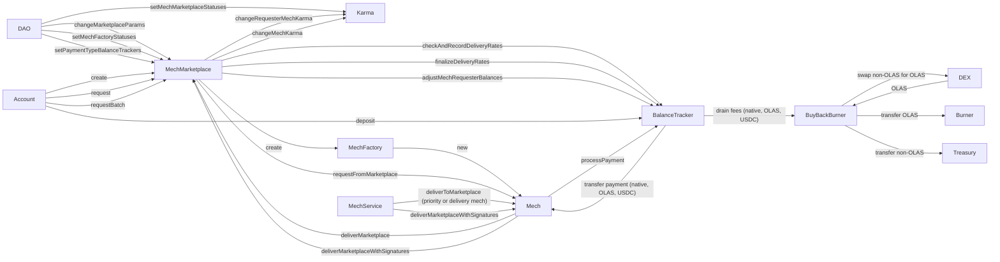

# Autonolas Marketplace

## Bounty Program
:mega::satellite::boom: The Autonolas bounty program and its details are available [here](https://immunefi.com/bounty/autonolas/).

## Introduction

This repository contains the Mech Marketplace set of contracts registering mechs and performing their interactions for requests
delivery via the means of the Marketplace. The core workflow of the Marketplace, including the roles and interactions of key
participants, as well as an overview of the smart contracts, can be found [here](https://github.com/valory-xyz/autonolas-marketplace/tree/main/docs/MechMarketplaceDescriptionAndContractsOverviewRepo.pdf).

## Architecture diagram



## Development

### Prerequisites
- This repository follows the standard [`Hardhat`](https://hardhat.org/tutorial/) development process.
- The code is written on Solidity `0.8.28`.
- The standard versions of Node.js along with Yarn are required to proceed further (confirmed to work with Yarn `1.22.19` and npx/npm `10.8.2` and node `v20.18.1`).

### Install the dependencies
The project has submodules to get the dependencies. Make sure you run `git clone --recursive` or init the submodules yourself.
The dependency list is managed by the `package.json` file, and the setup parameters are stored in the `hardhat.config.js` file.
Simply run the following command to install the project:
```
yarn install
```

### Core components
The contracts, deployment scripts and tests are located in the following folders respectively:
```
contracts
scripts
test
```

### Compile the code and run
Compile the code:
```
npx hardhat compile
```
Run the tests:
```
npx hardhat test
```

Delivery payload checks:
```sh
npx hardhat test test/MechMarketplaceDeliveryPayload.js
```
These tests cover empty responses and atomic batch rejection for native and ERC-20 payment,
all three signed-delivery overloads with EOA and EIP-1271 requesters, processed-response validation,
and ordinary delivery compatibility with the checked-in legacy factory artifact. The Marketplace
settlement interface is unchanged. Existing mechs do not gain the new wrapper check.

On all three signed-delivery paths and the updated ordinary delivery wrapper, one empty response
reverts the entire batch. Otherwise valid items in that transaction are not settled or paid, and
earlier state changes are rolled back. The caller must correct or remove the empty-response item
and resubmit. Signed paths check the supplied `deliveryData`; the ordinary wrapper checks the
processed response returned by `_preDeliver`.

### Explicit-nonce typed-data signatures

The explicit-nonce path uses a separate standard EIP-712 domain:

```js
{ name: "MechMarketplace", version: "2", chainId, verifyingContract: marketplaceProxyAddress }
```

Its signed type is:

```text
ExplicitNonceDelivery(address mech,address requester,bytes data,uint256 maxDeliveryRate,bytes32 paymentType,uint256 nonce,uint256 deadline)
```

`data` is the raw request bytes; the EIP-712 encoder hashes it. The requester signs the maximum rate,
while settlement can charge an actual rate up to that cap. `deadline` is the last Unix timestamp,
in seconds, at which settlement is allowed. Settlement after that timestamp reverts. Setting `deadline`
to `0` makes the authorization expired; it does not disable the expiry check. One expired item reverts
the entire batch. The contract does not impose a maximum authorization lifetime. Exact-request replay remains blocked;
independently signed requests with different nonces can settle in any order.

`getDomainSeparatorWithNonce()` exposes this standard domain. `getRequestIdWithNonce` now takes
`(mech, requester, data, maxDeliveryRate, paymentType, nonce, deadline)`. The explicit-nonce settlement
overload in Marketplace and OlasMech now takes an additional `uint256[] deadlines` after `nonces`.

**Client migration:** this replaces the old custom explicit-nonce digest and no-deadline selector.
Old explicit-nonce signatures and calls are not accepted by the new path. Clients must update their
ABI and typed-data payload; mechs forwarding the old explicit-nonce selector need updated bytecode.
The Marketplace upgrade must support the new selector before the new wrapper is used. The two older
sequential-nonce signed paths keep their selectors, hashes and legacy domain version `1.1.0`, and do
not gain expiry. `getDomainSeparator()` continues to expose their legacy domain; do not use it for
the new explicit-nonce signatures. No storage layout changes are introduced.

**Deployment requirements:** this source update is included in
[Marketplace PR 208](https://github.com/valory-xyz/autonolas-marketplace/pull/208).
Activating it requires deploying the new Marketplace implementation, executing an authorized
proxy upgrade via `changeImplementation(newImplementation)`, and deploying factories/mechs with the
updated wrapper before using the new path. Clients must migrate their ABI and signing payload.
Merging the PR alone does not change deployed behavior. The two legacy paths remain nonstandard even
after this upgrade; standardizing them requires a separate breaking migration or replacement deployment.

EOA clients can sign with the standard typed-data signing API. Contract-wallet clients must use their
wallet's supported ERC-1271 signing flow; the signature bytes are forwarded unchanged to the wallet.
The tests include an actual 2-of-2 Safe with its compatibility fallback handler, alongside mock-wallet
controls for opaque signatures and rejected, reverted or malformed validation responses.

```sh
npx hardhat test test/MechMarketplaceTypedNonce.js
```

These tests compare Solidity hashes against an independent typed-data encoder, exercise deadline
boundaries and atomic rollback, reject altered fields and domains, and check replay and retirement of
the old explicit-nonce selector. EOA, ERC-1271 and Safe settlement are covered with native and ERC-20
payments. Indexed organization-code searches found no signing client using `getRequestIdWithNonce`;
that search does not establish whether external clients use the retired interface. Client inventory
and migration must be confirmed before deployment.

Domain separator upgrade regression tests (Solidity 0.8.30):
```sh
forge test --use 0.8.30 --match-contract '^MechMarketplaceDomainSeparatorTest$' \
  --skip ImportWETH.sol --skip Proposal01FeeActivation -vv
```
The skips exclude the Solidity 0.5 WETH import and the unrelated historical proposal replay.
The tests use the checked-in deployment artifact as the legacy implementation, exercise a chain-ID
change followed by an upgrade, and check chain binding across all three signature paths. Pre-upgrade
EOA signatures and ERC-1271 approvals are preserved on the two legacy paths; explicit-nonce signatures
use the new format described above.
The Hardhat suite also compiles a fixture with a different contract `VERSION` to check that the signature
domain remains pinned to `1.1.0`. This fixture is compiled in memory without changing source files.

Opt-in checks for the eight deployments in `docs/configuration.json`:
```sh
RUN_MARKETPLACE_DOMAIN_FORKS=true forge test --use 0.8.30 \
  --match-contract ForkMechMarketplaceDomainSeparatorTest \
  --skip ImportWETH.sol --skip Proposal01FeeActivation --threads 2 -vv
```
RPC endpoints, block numbers, timestamps and proxy addresses are recorded in
`test/fixtures/domain-separator-forks.json`. The tests assert the chain Id, EVM block number and timestamp;
`blockHash` is informational metadata and is not asserted. These tests require RPC access to the pinned state and
simulate owner-authorized upgrades locally; they do not broadcast transactions. They check domain and
request-hash equality, retained root storage and selected mapping values. A separator mismatch is a
failed deployment gate and must be investigated before an upgrade. The local integration tests cover
settlement; the deployment forks do not submit deliveries for existing services.
Arbitrum's fixture distinguishes the L2 RPC height from the L1 block number exposed to EVM code.

### Linters
- [`ESLint`](https://eslint.org) is used for JS code.
- [`solhint`](https://github.com/protofire/solhint) is used for Solidity linting.


### Github Workflows
The PR process is managed by github workflows, where the code undergoes
several steps in order to be verified. Those include:
- code installation
- running linters
- running tests


## Governance proposals
On-chain governance proposals targeting the MechMarketplace stack live under
[`scripts/proposals/`](https://github.com/valory-xyz/autonolas-marketplace/blob/main/scripts/proposals).
Each proposal has its own folder with a Forge calldata builder, `description.txt`, and `README.md`;
L1 effects are verified by fork tests under
[`test/proposals/`](https://github.com/valory-xyz/autonolas-marketplace/blob/main/test/proposals).
See [`scripts/proposals/README.md`](https://github.com/valory-xyz/autonolas-marketplace/blob/main/scripts/proposals/README.md)
for the proposal index.

## Deployment and redeployment
The deployment of contracts to the test- and main-net is split into step-by-step series of scripts for more control and checkpoint convenience.
The description of deployment procedure can be found here: [deployment](https://github.com/valory-xyz/autonolas-marketplace/blob/main/scripts/deployment).

The finalized contract ABIs for deployment and their number of optimization passes are located here: [ABIs](https://github.com/valory-xyz/autonolas-marketplace/blob/main/abis).
Each folder there contains contracts compiled with the solidity version before their deployment.

The actual list of contract addresses for different chains and their full contract configuration can be found [here](https://github.com/valory-xyz/autonolas-marketplace/blob/main/docs/configuration.json).

### Previous versions, to be deprecated soon

The older list of contract addresses for different chains and their full contract configuration can be found [here](https://github.com/valory-xyz/autonolas-marketplace/blob/main/docs/configuration_v0.json).

| Network | AI Agent Registry    | AgentFactory    | AgentFactorySubscription   | MechMarketplace   |
| :---:   | :---: | :---: | :---: | :---: |
| Gnosis | https://gnosisscan.io/address/0xE49CB081e8d96920C38aA7AB90cb0294ab4Bc8EA   | https://gnosisscan.io/address/0x6D8CbEbCAD7397c63347D44448147Db05E7d17B0   | n/a   | https://gnosisscan.io/address/0x4554fE75c1f5576c1d7F765B2A036c199Adae329  |
| Gnosis | https://gnosisscan.io/address/0xaed729d4f4b895d8ca84ba022675bb0c44d2cd52   | n/a   | https://gnosisscan.io/address/0x910Ca843Cad6C050Faf3f84387879b2928D40370   | n/a   |
| Arbitrum | tbd   | https://arbiscan.io/address/0x4a46537dd58e524d4df68275946b022ea6623f71   | n/a   | n/a   |
| Arbitrum | https://arbiscan.io/address/0xa4799b083e0068732456ef45ff9fe5c683658327   | n/a   | https://arbiscan.io/address/0xd8bcc126ff31d2582018715d5291a508530587b0   | n/a   |
| Polygon | tbd   | https://polygonscan.com/address/0xd421f433e36465b3e558b1121f584ac09fc33df8   | n/a   | n/a   |
| Polygon | https://polygonscan.com/address/0x984cf72fde8b5aa910e9e508ac5e007ae5bdcc9c   | n/a   | https://polygonscan.com/address/0x6e7f594f680f7abad18b7a63de50f0fee47dfd06   | n/a   |
| Base | tbd   | https://basescan.org/address/0x75d529fae220bc8db714f0202193726b46881b76   | n/a   | n/a   |
| Base | https://basescan.org/address/0x88de734655184a09b70700ae4f72364d1ad23728   | n/a   | https://basescan.org/address/0x87c511c8ae3faf0063b3f3cf9c6ab96c4aa5c60c   | n/a   |
| Celo | tbd   | https://celoscan.io/address/0x87c511c8aE3fAF0063b3F3CF9C6ab96c4AA5C60c   | n/a   | n/a   |
| Celo | https://celoscan.io/address/0xE49CB081e8d96920C38aA7AB90cb0294ab4Bc8EA   | n/a   | https://celoscan.io/address/0x88DE734655184a09B70700aE4F72364d1ad23728   | n/a   |
| Optimism | tbd   | https://optimistic.etherscan.io/address/0x47135D1Cf850d7Df7f7f563F300cc7022F7978a4  | n/a   | n/a   |
| Optimism | https://optimistic.etherscan.io/address/0x75D529FAe220bC8db714F0202193726b46881B76   | n/a   | https://optimistic.etherscan.io/address/0x1BD1505B711Fb58C54ca3712e6BEf47A133892d9  | n/a   |


### Static audit of the deployed setup
The deployed contracts' on-chain configuration is checked against the values committed in
[`docs/configuration.json`](./docs/configuration.json) by a static audit script. It compares live wiring,
ownership and deployed bytecode against the repository's own artifacts, and exits non-zero on a mismatch:
```
node scripts/audit_chains/audit_contracts_setup.js
```

### Audits
- The latest external audit is the [Cantina January 2025 audit](https://github.com/valory-xyz/autonolas-marketplace/blob/main/audits/cantina_valory_january2025.pdf). All internal and external audit materials are in the [audits](https://github.com/valory-xyz/autonolas-marketplace/tree/main/audits) folder.
- A list of known vulnerabilities can be found here: [Vulnerabilities list](https://github.com/valory-xyz/autonolas-marketplace/blob/main/docs/Vulnerabilities_marketplace.md).


## Acknowledgements
The registry mech contracts were inspired and based on the following sources:
- [Rari-Capital Solmate](https://github.com/Rari-Capital/solmate).
- [Autonolas Registries](https://github.com/valory-xyz/autonolas-registries).
- [Gnosis Mech](https://github.com/gnosis/mech).
- [Safe Ecosystem Safe Contracts](https://github.com/safe-global/safe-contracts).
- [OpenZeppelin Contracts](https://github.com/OpenZeppelin/openzeppelin-contracts).
